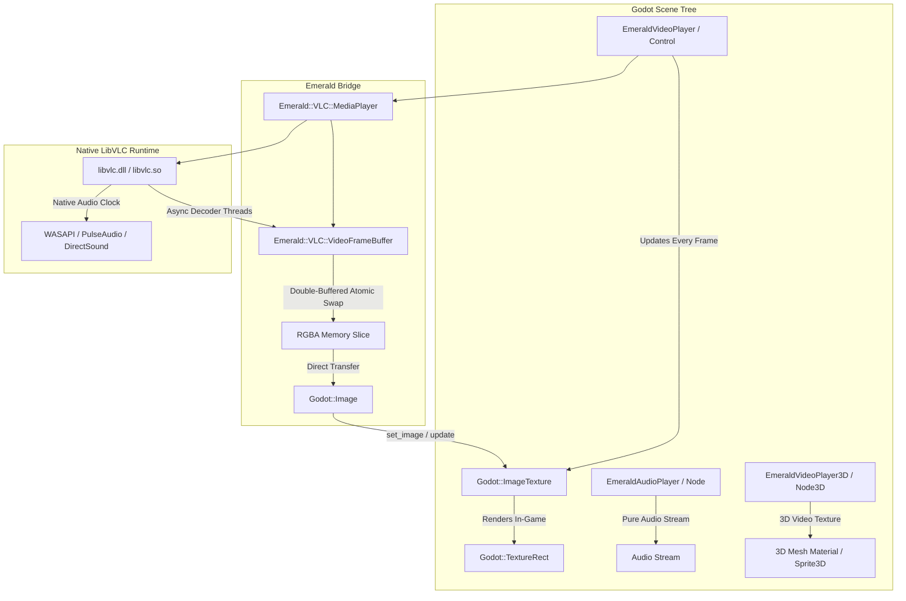

# Emerald for Lapis 🎬

<!-- carbon:badges -->
[](https://crystal-lang.org)
[](LICENSE)
[](https://godotengine.org)
[](https://www.videolan.org)
<!-- /carbon:badges -->

**Emerald** provides high-performance **LibVLC** multimedia bindings and dedicated video/audio player nodes for **Lapis** (Godot Engine 4.8+ Crystal GDExtension bindings).

It empowers game developers to play **any modern video and audio container or network stream** inside Godot with premium features: embedded & external subtitles, metadata inspection, multi-track audio/video selection, 10-band graphic equalizer, and hardware-accelerated texture presentation.

---

## Architecture Overview



---

## Features

- **Universal Format & Codec Playback**:
  - **Video**: MP4, MKV, WebM, AVI, MOV, FLV, MPEG-TS, H.264, HEVC/H.265, VP9, AV1.
  - **Audio**: MP3, FLAC, OGG Vorbis, Opus, AAC, WAV, ALAC, WMA.
  - **Live Streams**: HLS (`.m3u8`), RTSP, RTMP, HTTP/HTTPS audio & video streams, internet radio.
- **Hardware Video Acceleration & Two-Tier DSL**:
  - Cross-platform GPU decoding via `Emerald::Core::HardwareAcceleration` (`D3D11VA`, `DXVA2`, `VAAPI`, `VDPAU`, `VideoToolbox`, `MediaCodec`, `NVDEC`, `Auto`, `None`) and `Emerald::Core::VideoDecoderConfig`.
  - Ergonomic declarative configuration via `Emerald.media` / `Emerald.decoder_config` and `Emerald::DSL::MediaBuilder`.
- **Double-Buffered Zero-Tear Rendering**: Decouples asynchronous LibVLC decoder threads from Godot's main graphics loop with mutex-guarded atomic surface swapping.
- **Ready-to-Use Godot Nodes**:
  - `EmeraldVideoPlayer` (`Control`): Full-featured UI player for cutscenes, menus, and HUD media players.
  - `EmeraldAudioPlayer` (`Node`): Ultra-lightweight player for music, ambient soundscapes, dialog, and online radio streams without video overhead.
  - `EmeraldVideoPlayer3D` (`Node3D`): In-game 3D world player for arcade machines, cinema screens, monitors, and billboards.
- **Subtitles & Closed Captions (SPU)**:
  - Enumerate and switch between embedded subtitle tracks.
  - Attach external subtitle files (`.srt`, `.vtt`, `.sub`, `.ass`) dynamically.
  - Fine-tune subtitle synchronization with millisecond delays.
- **Multi-Track Audio & Video**:
  - Switch between multi-language dubs, alternate commentary tracks, and camera angles.
  - Audio delay adjustment for lip-sync correction.
- **10-Band Graphic Equalizer**:
  - 18 standard industry presets (`Rock`, `Pop`, `Jazz`, `Classical`, `FullBass`, `Techno`, `Vocal`, etc.).
  - Manual pre-amplification and per-band dB gain adjustments (-20 dB to +20 dB).
- **Metadata Inspection**:
  - Parse ID3, Vorbis, and MP4 tags (Title, Artist, Album, Genre, Year, Track Number, Artwork URL).
  - Inspect stream resolutions, aspect ratios, frame rates, and channel layouts.

---

## Installation

Add `emerald` to your game's `shard.yml`:

```yaml
dependencies:
  lapis:
    github: sol-vin/lapis
    branch: master
  emerald:
    github: sol-vin/emerald
    branch: main

development_dependencies:
  carbon:
    github: sol-vin/carbon
    branch: main
  jasper:
    github: sol-vin/jasper
    branch: main
```

Run `shards install` to install dependencies.

### LibVLC Runtime Prerequisite
- **Windows**: Install standard 64-bit VLC Media Player from [videolan.org](https://www.videolan.org). Emerald automatically detects `C:\Program Files\VideoLAN\VLC`, sets `VLC_PLUGIN_PATH`, and configures DLL discovery.
- **Linux (Ubuntu/Debian)**: `sudo apt install libvlc-dev vlc-plugin-base`
- **Arch Linux**: `sudo pacman -S vlc`
- **macOS**: `brew install vlc`

---

## Quickstart

Require `emerald` in your game's entry point:

```crystal
require "lapis"
require "emerald"
```

### 1. Playing a Cutscene with `EmeraldVideoPlayer`

```crystal
node MainMenu < Control do
  def _ready : Void
    player = EmeraldVideoPlayer.new
    player.source = "res://videos/cinematic_intro.mp4"
    player.volume = 100
    player.aspect_mode = "Fit"
    player.autoplay = true

    # Connect to completion signal
    player.playback_finished.connect do
      Godot.print("Intro finished, displaying start button!")
    end

    add_child(player)
  end
end
```

### 2. Streaming Internet Radio with `EmeraldAudioPlayer`

```crystal
node RadioStation < Node do
  def _ready : Void
    radio = EmeraldAudioPlayer.new
    radio.source = "https://stream.radioparadise.com/flac"
    radio.volume = 85
    radio.equalizer_preset = "Rock"
    radio.play

    radio.metadata_loaded.connect do
      if meta = radio.get_metadata
        Godot.print("Playing: #{meta.title} by #{meta.artist}")
      end
    end

    add_child(radio)
  end
end
```

### 3. Rendering Video on a 3D Cinema Screen

```crystal
node CinemaHall < Node3D do
  def _ready : Void
    player = EmeraldVideoPlayer3D.new
    player.create_sprite3d = false
    player.source = "res://videos/feature_film.mkv"
    player.loop = true
    player.play
    add_child(player)

    # Apply live video texture to the cinema screen material
    screen = get_node_as(Godot::MeshInstance3D, "ScreenMesh")
    if mat = screen.get_active_material(0).as?(Godot::StandardMaterial3D)
      mat.albedo_texture = player.video_texture
    end
  end
end
```

---

## CLI Multimedia Metadata Inspector

Emerald includes a standalone command-line media analyzer:

```bash
# Build the CLI tool
shards build emerald-inspect

# Analyze any media file or stream URL
bin/emerald-inspect "path/to/media.mp4"
bin/emerald-inspect "https://stream.radioparadise.com/flac"
```

---

## Documentation

Comprehensive multi-track guides and API references are compiled via **Jasper** (`jasper.yml`):
- Run `bin/jasper build` to regenerate documentation modules.
- Run `crystal docs` to generate the offline HTML documentation site.

---

## License

MIT License. Designed and developed with love for the Lapis and Godot communities.
